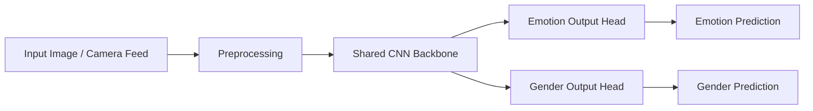

# Real-Time Emotion Recognition and Gender Classification


A deep learning project for real-time emotion recognition and gender classification using image and live camera inputs. The system uses a multi-task CNN architecture to classify seven emotional states and two gender labels in a single end-to-end pipeline.

## Overview

This project focuses on human-centered computer vision and affective computing. It demonstrates how facial images can be processed using a convolutional neural network to infer emotional state and gender, which is relevant to human-computer interaction, smart environments, and intelligent interface design.

## Why This Project Matters

- Demonstrates deep learning in visual emotion analysis
- Combines emotion and gender recognition in one model pipeline
- Supports real-time webcam inference for live demonstrations
- Highlights applied AI and computer vision skills in a practical setting

## Key Features

- 7 emotion classes
- 2 gender classes
- Static image inference
- Live camera prediction
- Multi-task CNN architecture for shared feature learning
- Model training and evaluation workflow

## Architecture



## Repository Structure

```text
emotion-recognition-gender-classification/
├── README.md
├── requirements.txt
├── .gitignore
├── src/
│   ├── __init__.py
│   ├── config.py
│   ├── data_loader.py
│   ├── model.py
│   ├── train.py
│   ├── inference.py
│   └── live_demo.py
├── data/
│   ├── train/
│   └── validation/
├── models/
│   └── training_history.json
└── .gitkeep
```

## Tech Stack

- Python 3.10+
- TensorFlow / Keras
- OpenCV
- NumPy
- Matplotlib
- scikit-learn
- pandas

## Supported Classes

### Emotions

- Angry
- Disgust
- Fear
- Happy
- Neutral
- Sad
- Surprise

### Gender

- Male
- Female

## Quick Start

### 1. Clone the repository

```bash
git clone https://github.com/Fs-ilm26/emotion-recognition-gender-classification.git
cd emotion-recognition-gender-classification
```

### 2. Create a virtual environment

```bash
python -m venv .venv
source .venv/bin/activate
```

### 3. Install dependencies

```bash
pip install -r requirements.txt
```

### 4. Train the model

```bash
python src/train.py
```

### 5. Run image classification

```bash
python src/inference.py --image path/to/sample.jpg --model models/emotion_gender_model.keras
```

### 6. Run live camera demo

```bash
python src/live_demo.py --model models/emotion_gender_model.keras --camera 0
```

## Dataset Layout

```text
data/
├── train/
│   ├── angry/
│   ├── disgust/
│   ├── fear/
│   ├── happy/
│   ├── neutral/
│   ├── sad/
│   └── surprise/
└── validation/
    ├── angry/
    ├── disgust/
    ├── fear/
    ├── happy/
    ├── neutral/
    ├── sad/
    └── surprise/
```

## Model Design

The model is built using a shared CNN backbone followed by two classification heads:

- emotion output head for 7 classes
- gender output head for 2 classes

This multitask approach reduces redundant computation while enabling simultaneous predictions from a single input.

## Evaluation Strategy

The system can be evaluated using:

- accuracy
- loss curves
- confusion matrices
- per-class performance analysis

## Potential Applications

- Human-computer interaction systems
- Emotion-aware interfaces
- Smart retail and customer experience analytics
- Affective computing research prototypes

## Project Impact

This project demonstrates the ability to build a practical image classification application for real-time human analysis. It reflects strong skills in deep learning, computer vision, and AI model development for real-world use cases.

## License

This project is licensed under the MIT License.

## Future Enhancements

- Face detection and alignment preprocessing
- Attention-based architecture improvements
- Web interface for interactive evaluation
- Deployment as a Streamlit or Flask application

---

This repository is presented as a professional, portfolio-ready project in the field of computer vision and human emotion analysis.
