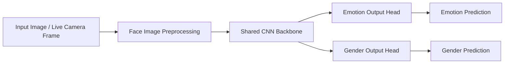

# Real-Time Emotion Recognition and Gender Classification


A deep learning-based facial analysis project that performs real-time emotion recognition and gender classification from static images and live camera feeds. The repository uses a multi-task CNN architecture to classify seven emotional states and two gender labels in a single inference pipeline.

## Overview

This project focuses on human-centered AI by recognizing facial expressions and gender from visual input. It is designed for computer vision research, interactive AI systems, and prototype deployment scenarios where efficient real-time classification is important.

## Why This Project Matters

- Demonstrates CNN-based facial recognition and analysis
- Combines emotion classification and gender prediction in one model
- Supports real-time camera inputs for live classification
- Highlights practical AI application in human-computer interaction

## Key Highlights

- 7 emotion classes
- 2 gender classes
- Live webcam inference support
- Static image prediction pipeline
- Multi-task CNN for shared feature learning
- Training and evaluation workflow for model improvement

## Project Architecture



## Repository Structure

```text
emotion-recognition-gender-classification/
├── README.md
├── requirements.txt
├── .gitignore
├── src/
│   ├── __init__.py
│   ├── config.py
│   ├── data_loader.py
│   ├── model.py
│   ├── train.py
│   ├── inference.py
│   └── live_demo.py
├── data/
│   ├── train/
│   └── validation/
├── models/
│   └── training_history.json
└── .gitkeep
```

## Tech Stack

- Python 3.10+
- TensorFlow / Keras
- OpenCV
- NumPy
- Matplotlib
- scikit-learn
- pandas

## Supported Classes

### Emotions

- Angry
- Disgust
- Fear
- Happy
- Neutral
- Sad
- Surprise

### Gender

- Male
- Female

## Quick Start

### 1. Clone the repository

```bash
git clone https://github.com/Fs-ilm26/emotion-recognition-gender-classification.git
cd emotion-recognition-gender-classification
```

### 2. Create a virtual environment

```bash
python -m venv .venv
source .venv/bin/activate
```

### 3. Install dependencies

```bash
pip install -r requirements.txt
```

### 4. Train the model

```bash
python src/train.py
```

### 5. Run inference on a single image

```bash
python src/inference.py --image path/to/sample.jpg --model models/emotion_gender_model.keras
```

### 6. Run live camera detection

```bash
python src/live_demo.py --model models/emotion_gender_model.keras --camera 0
```

## Dataset Format

A typical dataset layout is:

```text
data/
├── train/
│   ├── angry/
│   ├── disgust/
│   ├── fear/
│   ├── happy/
│   ├── neutral/
│   ├── sad/
│   └── surprise/
└── validation/
    ├── angry/
    ├── disgust/
    ├── fear/
    ├── happy/
    ├── neutral/
    ├── sad/
    └── surprise/
```

The model architecture is designed to be easily extended for annotated gender metadata as well.

## Model Design

The core system uses a shared CNN backbone to extract important visual features from facial images, followed by two task-specific classification heads:

- Emotion classification head
- Gender classification head

This design enables efficient multi-task learning and demonstrates a practical AI approach for simultaneous classification tasks.

## Evaluation and Metrics

The model is evaluated using standard classification metrics including:

- Accuracy
- Loss curves
- Confusion matrix analysis (when extended with labeled datasets)
- Per-class performance review

## Demo / Sample Output

> Add a live-capture screenshot or a sample prediction result here for a polished recruitment-facing presentation.

```text
Sample Prediction
----------------
Emotion: Happy
Gender: Female
```

## Potential Applications

- Human-computer interaction systems
- Smart retail analytics
- Adaptive interfaces and emotion-aware systems
- Research prototypes in affective computing

## Project Impact

This project highlights the ability to build a practical deep learning system that analyzes human facial expressions and demographic attributes in real time. It reflects strong potential in applied AI, image classification, and computer vision research.

## License

This project is licensed under the MIT License.

## Future Enhancements

- Face detection and alignment for better robustness
- Improved attention-based architectures
- Web-based interactive dashboard
- Deployment as a Streamlit or Flask application

---

This project is presented as a professional image-classification solution for real-time human emotion and gender analysis.
